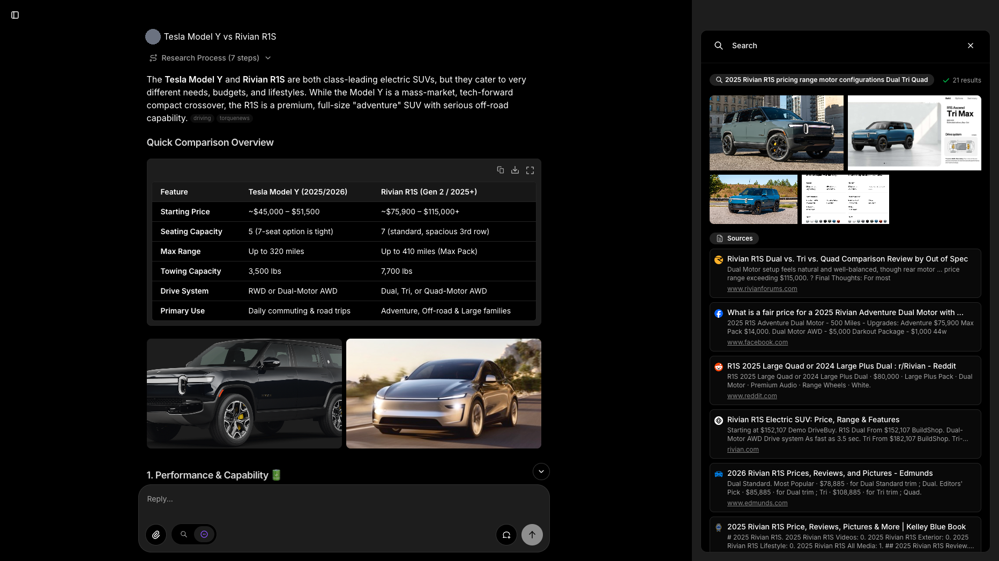

<div align="center">

# Morphic

An AI-powered search engine with a generative UI.

[![DeepWiki](https://img.shields.io/badge/DeepWiki-miurla%2Fmorphic-blue.svg?logo=)](https://deepwiki.com/miurla/morphic) [](https://github.com/miurla/morphic/stargazers) [](https://github.com/miurla/morphic/network/members)

<a href="https://vercel.com/oss">
  
</a>

<br />
<br />

<a href="https://trendshift.io/repositories/9207" target="_blank"></a>



</div>

## Features

- AI-powered search with grounded, cited answers
- Generative UI — answers render rich inline components (source-credited images, grids, headings) live from a streamed JSON spec, beyond plain markdown
- Search modes: Quick and Adaptive
- Model selector with dynamic provider detection (OpenAI, Anthropic, Google, Ollama, Vercel AI Gateway, OpenAI-compatible providers)
- Multiple search providers (Tavily, SearXNG, Brave, Exa)
- Chat history stored in PostgreSQL
- Share search results with unique URLs
- File upload support
- Tutor workspace: learning paths from PDF, TXT, Markdown and DOCX files, cited lessons, practice and assessed mastery — see [Tutor setup and RAG evaluation](./docs/TUTOR.md)
- User authentication with built-in accounts (Better Auth) or Supabase Auth
- Guest mode for anonymous usage
- Docker deployment ready

## Installation

### Docker (Recommended)

Build this repository's Tutor-enabled image with Docker Compose. The bundled
configuration uses `morphic:tutor-local` for both the Web app and Tutor worker,
and `pgvector/pgvector:pg17` for PostgreSQL with vector search. The upstream
`ghcr.io/miurla/morphic:latest` image does not include this fork's Tutor changes.

1. Clone the repository and configure environment:

```bash
git clone https://github.com/PothomK/Tutor.git
cd Tutor
cp .env.local.example .env.local
```

2. Edit `.env.local`. For an OpenAI teaching model and embeddings, a minimal
   local Tutor configuration is:

```dotenv
OPENAI_API_KEY=your_openai_key
TUTOR_MODEL=openai:gpt-5.4-mini
TUTOR_EMBEDDING_BASE_URL=https://api.openai.com/v1
TUTOR_EMBEDDING_MODEL=text-embedding-3-small
# Embeddings reuse OPENAI_API_KEY unless TUTOR_EMBEDDING_API_KEY is set.
TUTOR_STORAGE_DRIVER=local
```

Use a model available to your account that supports structured JSON output.
See [Tutor API keys](#tutor-api-keys) below for separate teaching and embedding
providers. Local file storage uses the shared `tutor_data` volume; S3/R2 storage
is also supported.

3. Build and start the Web app, Tutor worker and supporting services:

```bash
docker compose --profile tutor up -d --build
docker compose --profile tutor ps
docker compose logs --tail=100 tutor-worker
```

4. Visit [http://localhost:3000/tutor](http://localhost:3000/tutor). The worker logs
   `[Tutor worker] Ready` when it has started. The main search UI remains at
   [http://localhost:3000](http://localhost:3000).

Compose starts PostgreSQL, Redis, SearXNG, Morphic and the Tutor worker. The Web
entrypoint applies database migrations before the worker starts. Both processes
share `.env.local`, the database, Redis and document storage. No search API key
is required for Tutor; the search UI uses the included SearXNG service.

To run only the Web app and supporting services while configuring Tutor, use
`docker compose up -d --build`. Tutor processing also requires the worker; start
it after configuration with `docker compose --profile tutor up -d tutor-worker`.

After pulling code updates, run `docker compose --profile tutor up -d --build`
again to rebuild and recreate both app containers. Back up existing PostgreSQL
data before applying migrations or switching database images. Keep the named
volumes; `docker compose down -v` deletes stored data.

To override the app image tag, set `MORPHIC_IMAGE` in your shell or Compose's
project `.env` file. `.env.local` supplies container settings and is not used for
Compose `${...}` interpolation by default. The default anonymous mode is for
personal use; configure authentication before sharing a deployment.

See [Tutor setup](./docs/TUTOR.md) for worker, storage and migration details, and
the [configuration guide](./docs/CONFIGURATION.md) for authentication.

### Tutor API keys

Configure these values in `.env.local`, which is read by both the Web app and the
Tutor worker. Tutor requires a teaching model and an embedding service. They may
share one API key when the provider supports both capabilities; configuring a
chat model alone does not establish embedding support.

#### Teaching model (required)

The teaching model plans courses, generates lessons and grades answers. It must
support structured JSON output.

Set `TUTOR_MODEL` to a provider and model ID, such as `openai:gpt-5.4-mini`.
Configure the credentials for your chosen provider:

- OpenAI: `OPENAI_API_KEY`.
- Anthropic: `ANTHROPIC_API_KEY`.
- Google: `GOOGLE_GENERATIVE_AI_API_KEY`.
- Vercel AI Gateway: `AI_GATEWAY_API_KEY`.
- OpenAI-compatible providers: `OPENAI_COMPATIBLE_API_KEY` and
  `OPENAI_COMPATIBLE_API_BASE_URL`.
- Ollama: `OLLAMA_BASE_URL`. No teaching API key is needed for a local Ollama
  service, but Tutor still requires an embedding service.

If `TUTOR_MODEL` is omitted, Tutor first uses the first nonempty model in
`OPENAI_COMPATIBLE_MODELS` when that provider is configured. Otherwise, it uses
the application's default OpenAI model when OpenAI is configured. Set
`TUTOR_MODEL` explicitly for other providers.

#### Embedding service (required)

The embedding service indexes documents and retrieves relevant source material.
It must provide an OpenAI-compatible embeddings endpoint, accept the dimensions
parameter and return **1536-dimensional** vectors.

- API key: `TUTOR_EMBEDDING_API_KEY`. Falls back to `OPENAI_API_KEY`.
- Base URL: `TUTOR_EMBEDDING_BASE_URL`. Falls back to `OPENAI_BASE_URL`, then
  `https://api.openai.com/v1`. Tutor appends `/embeddings` to this base URL.
- Model: `TUTOR_EMBEDDING_MODEL`. Defaults to `text-embedding-3-small`.

Embedding settings do **not** inherit the OpenAI-compatible teaching provider's
key or base URL. Configure them explicitly for the embedding service.

Changing the embedding endpoint or model requires reindexing documents. See
[Tutor configuration](./docs/TUTOR.md#configuration).

#### Reranking service (optional)

Reranking refines the order of retrieved sources. It is disabled by default.
To enable it, configure all four settings:

- Enable reranking: set `TUTOR_RERANK_ENABLED` to `true`.
- Base URL: `TUTOR_RERANK_BASE_URL`.
- API key: `TUTOR_RERANK_API_KEY`.
- Model: `TUTOR_RERANK_MODEL`.

Tutor appends `/rerank` to the base URL. The service must support the request and
response contract described in [Tutor setup](./docs/TUTOR.md#rag-strategy).

#### Example configuration

For example, to use an OpenAI-compatible teaching provider and a separate
embedding service:

```dotenv
OPENAI_COMPATIBLE_API_KEY=your_teaching_provider_key
OPENAI_COMPATIBLE_API_BASE_URL=https://your-chat-provider.example/v1
OPENAI_COMPATIBLE_MODELS=your-teaching-model
TUTOR_MODEL=openai-compatible:your-teaching-model

TUTOR_EMBEDDING_API_KEY=your_embedding_provider_key
TUTOR_EMBEDDING_BASE_URL=https://your-embedding-provider.example/v1
TUTOR_EMBEDDING_MODEL=your-1536-dimensional-embedding-model

TUTOR_RERANK_ENABLED=false
TUTOR_STORAGE_DRIVER=local
```

Replace the example endpoints and model names with those supported by your
providers. Keep keys in `.env.local`; do not commit them.

#### Database, queue and file storage

Tutor also needs PostgreSQL with pgvector, a Redis TCP/TLS queue and private
document storage. The Compose setup supplies PostgreSQL and Redis; setting
`TUTOR_STORAGE_DRIVER=local` uses its shared document volume without storage API
keys. For S3/R2, configure `R2_ACCESS_KEY_ID`, `R2_SECRET_ACCESS_KEY`,
`R2_BUCKET_NAME`, and either `S3_ENDPOINT` or `R2_ACCOUNT_ID` instead.

After changing configuration, recreate the Web app and worker:

```bash
docker compose --profile tutor up -d
```

### Local Development

1. Clone and install:

```bash
git clone https://github.com/PothomK/Tutor.git
cd Tutor
bun install
```

2. Configure environment:

```bash
cp .env.local.example .env.local
```

Edit `.env.local` and set your API keys:

```bash
OPENAI_API_KEY=your_openai_key
TAVILY_API_KEY=your_tavily_key
```

To enable chat history, authentication, file upload, and other features, see [CONFIGURATION.md](./docs/CONFIGURATION.md).

For what a self-hosted instance sends outbound, and what is off by default, see [PRIVACY.md](./docs/PRIVACY.md).

3. Start the dev server:

```bash
bun dev
```

Visit http://localhost:3000.

## Deploy

### Vercel

[](https://vercel.com/new/clone?repository-url=https%3A%2F%2Fgithub.com%2Fmiurla%2Fmorphic&env=OPENAI_API_KEY,TAVILY_API_KEY,ENABLE_AUTH)

## Contributing

We welcome contributions! Please see our [Contributing Guide](CONTRIBUTING.md) for details on how to get started, including local development setup.

## License

This project is licensed under the Apache License 2.0 - see the [LICENSE](LICENSE) file for details.
